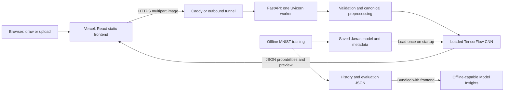
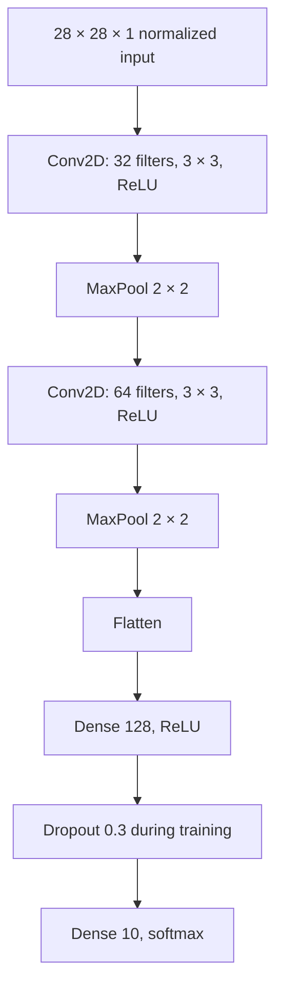
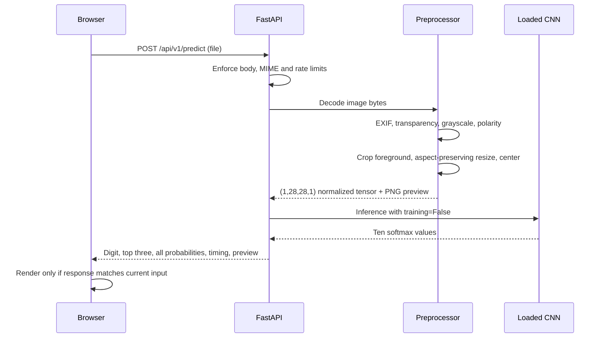
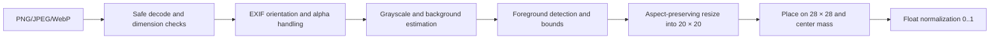

# NeuralInk architecture

## System and deployment

The frontend and API can use different domains and machines. The API URL is build configuration. Browser CORS checks compare the frontend origin against the API allowlist. HTTPS terminates at the public reverse proxy or tunnel provider. Uploaded images remain in request memory; no upload directory or database is required. Training is a separate command, never an API request or startup task.

## CNN

With valid convolutions, dimensions are 28→26→13→11→5. Flatten produces 1,600 values. Parameter counts: first convolution 320; second convolution 18,496; dense hidden layer 204,928; output 1,290; total **225,034**. Pooling, flatten, dropout and training augmentation have no learned parameters. The saved metadata is authoritative for the actual trained model.

## Request flow

Blank/corrupt/unsupported/oversized images return structured errors. The client distinguishes validation, connection, timeout and unavailable-model failures and can submit a new request. Cancellation and input-version checks prevent an old prediction from replacing a newer drawing. Softmax output is model confidence, not calibrated correctness probability.

## Preprocessing boundary

Both input modes call this exact backend implementation. Browser transport resizing or canvas serialization does not replace it. Foreground thresholds and contrast guards are deterministic heuristics and cannot guarantee reliable processing of textured photographs or multiple digits.

## Health and security

`/healthz` is process liveness. `/readyz` requires the real loaded model and successful initialization. `/api/v1/model/info` publishes actual metadata. One model instance is loaded per worker; use one worker unless memory and limiter design are deliberately revised. The body/pixel bounds protect memory, while the proxy caps total multipart traffic. Public error responses omit private stack traces. Trusted proxy behavior and process-local limiter constraints are described in DEPLOYMENT.md.
